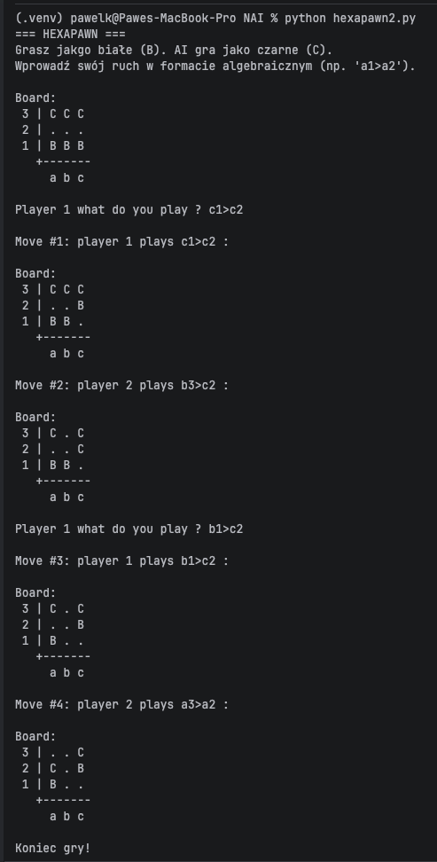

# Hexapawn z AI (adversarial search)

**Autorzy:** Maciej Moroz s32006, Paweł Kozłowski s30900
**Przedmiot:** NAI – Narzędzia Sztucznej Inteligencji
## Gra

Hexapawn na planszy **3×3** z 3 pionkami na gracza. Zasady: https://en.wikipedia.org/wiki/Hexapawn

- Pionek idzie o jedno pole do przodu na puste pole albo bije o jedno pole na skos.
- Przegrywasz, gdy pionek przeciwnika dotrze do Twojego rzędu bazowego albo nie masz żadnego ruchu.
- Gra jest turowa, deterministyczna, dwuosobowa, o sumie zerowej. Remis jest niemożliwy.

AI gra algorytmem **Negamax** (z alpha-beta pruning) z biblioteki [easyAI](https://zulko.github.io/easyAI/).

## Przygotowanie środowiska

```bash
python3 -m venv .venv
source .venv/bin/activate
pip install -r requirements.txt
```

## Uruchomienie

```bash
python hexapawn.py
```

Ruch wpisujesz jako `pole_startowe>pole_docelowe`, np. `b1>b2`.

## Przykładowa rozgrywka

